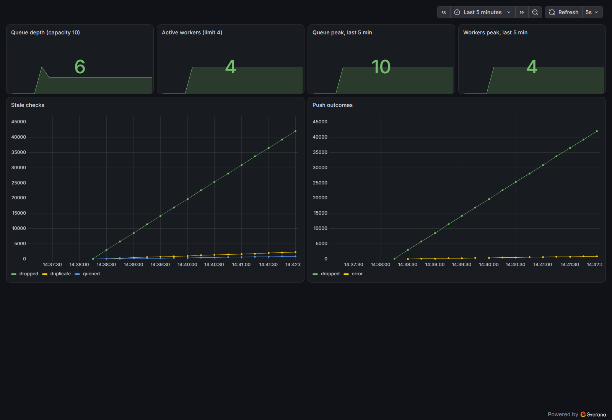

# Проверка лабораторной №3

Проверено 17 ноября 2026 года в ветке homework/03. Выполнена обязательная часть задания.

## Автоматические проверки

- go generate ./... — успешно.
- go test -race -count=2 -coverprofile=coverage.out ./... — успешно.
- go test -race -count=2 -tags=integration ./... — успешно на отдельном PostgreSQL 17.
- golangci-lint run — 0 issues.
- git diff --check — успешно.
- goleak.VerifyTestMain в пакете воркеров не обнаружил утечек.

Покрытие новых сценариев: сохранение координаты — 95%, получение маршрута — 100%,
пул — 91,5%, HTTP сохранения — 92,9%, HTTP маршрута — 88,9%, Push-гейтвей — 83,8%.
Тесты используют управляемое время и каналы для синхронизации.

Интеграционные сценарии проверяют атомарный откат, опоздавшую координату,
сортировку recorded_at/id, выборку свежих, завершённых поездок и поездок без координат.
На 6000 поездок EXPLAIN ANALYZE дважды показал Index Scan using
trips_status_position_time_idx, выбрано 10 строк. enable_seqscan не менялся.
Миграции таблицы и индексов проверены в обе стороны; индексы — down/down/up.

## Живое окружение

Использовано штатное окружение tripgo-lab-03 с релизным tripgoctl v0.1.2:
PostgreSQL, Push Service, OpenTelemetry Collector, Prometheus, Jaeger, Grafana.

HTTP-проверка: создана поездка, сохранены свежая и более старая координаты,
GET вернул обе в правильном порядке; last_position_at остался равен свежей.
После завершения поездки сохранение вернуло 409 trip_completed.

## Нагрузка и остановка

Вставлены 200 собственных тестовых активных поездок, начатых 10 минут назад.
Параметры проверки: POSITION_QUEUE_SIZE=10, POSITION_WORKERS=4,
POSITION_STALE_AFTER=60s, PUSH_REQUEST_TIMEOUT=1s, SHUTDOWN_TIMEOUT=5s.
Только на время проверки POSITION_CHECK_INTERVAL уменьшен до 1s для ускорения
наблюдения; штатное значение в конфигурации и .env.example — 30s.
В обычной работе секундный период использовать нельзя: он задаёт частоту повторных пушей.

Через POST /admin/behaviour заглушке задан latency_ms=5000, fail_rate=0.

| Наблюдение | Результат |
|---|---|
| Максимальная глубина очереди за 5 минут | 10 при ёмкости 10 |
| Максимум занятых воркеров | 4 при лимите 4 |
| Ответ GET /ready под нагрузкой | 39 мс, status=ok |
| Переполнение | счётчики dropped растут, сканер продолжает тики |
| Медленный Push | запросы отменяются по таймауту, следующие задачи обрабатываются |
| SIGTERM под нагрузкой | процесс вышел за 3126 мс при бюджете 5000 мс |
| Рестарт с теми же поездками | опрос возобновился без прогрева |

После сброса задержки в логах Push Service видны REQUEST_POSITION с result=accepted.
В Jaeger проверены positions.process с FOLLOWS_FROM (span link) на сканер и
push.REQUEST_POSITION с CHILD_OF на обработку задачи.

Размеры канала и структуры pending ограничены; горутины на задачи не создаются.
Это также проверяют конкурентные тесты пула. Короткий нагрузочный прогон
не является доказательством отсутствия роста памяти при любой длительности работы.

Дашборд для импорта в Grafana: [grafana-dashboard.json](grafana-dashboard.json).
После импорта выбрать штатный datasource с uid prometheus.
Скриншот показывает реальные измерения: очередь 6, воркеры 4, пики 10 и 4.
Счётчики dropped на графиках включают повторные попытки постановки на каждом тике,
поэтому могут превышать число тестовых поездок.

Задержка Push возвращена в 0; собственные тестовые поездки и временный PostgreSQL
удалены после проверки. Штатное окружение лабораторной оставлено запущенным.
